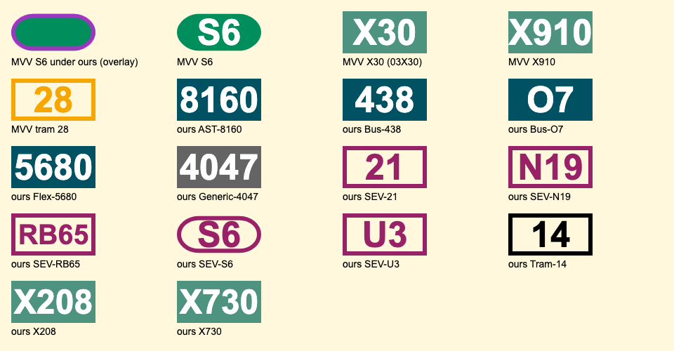

# Line icons MVV doesn't have

MVV names an icon for every line (`line.symbol` in departures and in
`available_lines`, e.g. `02019.svg`), and the server proxies it from
`https://www.mvv-muenchen.de/fileadmin/lines/` at `/svg/<file>`. For about one
line in eight, MVV doesn't have the file. The client then shows the line's
name as text, cut to three letters when it is longer than five (`SEV S6`
becomes `SEV...`).

This file records which icons are missing and what we serve instead.
`server/src/icons.ts` implements it, and `/svg/*filename` in
`server/src/handlers.ts` serves it.

The samples are in `docs/icons/`; `bazel run //server:icon_samples` redraws
them from the server's code. The preview above is a screenshot, so retake it
by hand after a change. Its top row is MVV's own icons.

## Survey

On 2026-11-07 we fetched `available_lines` for 1,487 of the 11,062 stops in
`server/data/stops.csv` (denser in Munich and Landkreis München), and checked
every icon they name. 420 distinct lines, 53 icons missing. Departures at 137
of those stops (4,503 departures) name the same icons as `available_lines`,
and no lines that it doesn't list.

## MVV's template

Every MVV icon is the same SVG: `viewBox="0 0 1000 500"`, a coloured
rectangle (a rounded pill for the S-Bahn), and the line's number centred in
bold Arial at 425px. Ours use the same template.

| Family | Background | Text |
| --- | --- | --- |
| Bus, regional bus, StadtBus, FLEXlinie | `#005262` | white |
| Express bus (X…) | `#4d9380` | white |
| HEX, Lufthansa Express | `#646464` | white |
| MetroBus | `#ec6726` | white |
| Night bus and night tram (MVG) | `#1d1d1b` | `#fbba00` |
| Regional night bus | `#f7a600` | white |
| Tram, U-Bahn, S-Bahn | one colour per line | white |

Tram 28 is drawn as an outline: an orange frame, orange number and no fill.

## What we serve

The SEV colour is `#992168`, the purple of the
[Ersatzverkehr sign](https://upload.wikimedia.org/wikipedia/commons/8/89/Schienenersatzverkehr_214544-288243.jpg).
An SEV icon is an outline in that colour with the line's name without "SEV"
(`SEV S6` shows `S6`), in the shape of the line it replaces: a pill for the
S-Bahn, a rectangle for everything else. Of MVV's icons only the S-Bahn's
differs from a rectangle, and MVV has none for regional trains (RB). Like
MVV's tram 28, it has no fill, so the row colour shows through.

| # | Class | Examples (MVV's file) | We serve |
| --- | --- | --- | --- |
| 1 | S-Bahn under its new line code | S1–S8 (`920S1`–`920S8`) | MVV's icon under the old code, `92M01`–`92M08`. `getFallback` does this today; its pattern should be `^920S\d`. |
| 2 | MVG express buses | X30, X35, X36, X80 (`20X30`…) | MVV's icon at `03X30`…, the right colour and label. |
| 3 | Regional express buses | X205, X206, X208, X730 (`20205`…) | Generated: `#4d9380`, label `X208`. MVV's `19208` is the plain regional bus (`208`, dark teal), so the client's `20208 → 19208` hack goes. |
| 4 | SEV for S-Bahn and DB regional trains | SEV S2, S6, S8 (`870S2`…), SEV RB6, RB65, RB67 (`87A03`, `87RB6`) | Generated SEV outline: `S6`, `RB65`. RB65 and RB67 share `87RB6.svg`, so the label must come from the line, not the file. |
| 5 | SEV for MVG lines | Tram 21, 25 (`345nn`), U3 (`35503`), N19 (`36719`), X6 (`35596`) | Generated SEV outline. MVV gives the replaced line's name (`U3`), so the label is the name as it is. |
| 6 | New or temporary MVG lines | Tram 14 (`02014`), bus O7 (`03407`) | Generated: tram 14 as a black (`#000000`) outline without fill, like MVV's tram 28; bus O7 `#005262`. |
| 7 | Regional on-demand and town buses | FLEXlinie 2100, 5010… (`16xxx`), AST 8150… (`lvg:`), StadtBus 724 Dachau (`65724`) | Generated: `#005262`. |
| 8 | Operators outside MVV | Allgäu (`rva:`), Oberbayern (`rvo:`), Inn (`mul:`), Tyrol (`vvt:`, the Innsbruck S6 `92AS6`), Regensburg (`gfn:`) | Generated: `#646464`. |
| 9 | MVV's own wrong icon | Bus 438 (`12438.svg` reads `9441`) | Generated in place of MVV's: `#005262`, `438`. |

Class 2 needs no drawing, so it stays as the rename above.

## How the server does it

The server keeps `/svg/<file>`, the generation option the owner chose:

1. Names that can't be MVV's are refused without asking MVV. All 417 icon
   names in the survey are five capitals or digits plus `.svg`.
2. Overrides: MVV files we replace even though they exist
   (`icons.overrides`, so far `12438.svg`).
3. MVV's file, sent with a 10-day max-age. If MVV answers 404 or 410, its
   file under another name: `920S<n>` → `92M0<n>`, `20X<nn>` → `03X<nn>`
   (`icons.renamedIcon`).
4. If MVV has neither, draw an icon (`icons.drawIcon`), sent with a 1-day max-age in
   case MVV adds the real one. The client passes the line as query
   parameters (`?name=SEV%20S6&product=Ersatzverkehr&id=ddb:870S6:A:H:j26`),
   because the file name alone can't say what to draw (see classes 4 and 5).
   `Departure.line.product` carries MVV's product (`line.name` in its
   replies: `SEV`, `Ersatzverkehr`, `ExpressBus`, `Tram`, `FLEXlinie`,
   `AST`…).

The server keeps MVV's answer for each file (the icon, or that it has none)
for a day, and requests arriving while MVV is being asked share that one
request. mvv-proxy also runs on the internet, so this keeps it from getting
rate-limited by MVV.

The cache doesn't stop someone asking for one made-up name after another,
so requests to MVV for icons are limited too (`ICON_LIMITS` in
`server/src/handlers.ts`):

- A budget: 1,500 at once, enough for a restart's empty cache, then about
  4,000 a day (one every 21.6 seconds).
  Only requests that reach MVV count, renames included. Normal use costs at
  most a few thousand a day, since each icon is asked for once a day; a
  busy stop's 50 icons are a burst, and mostly cached. When the budget is
  spent, the server answers 404 without asking MVV or keeping the answer
  (see below), logs it once, and the client shows the line's name.
- At most 8 requests to MVV at once. Over HTTP/2 a page asks for all its
  icons together.
- No retries: a missing icon only means text for a while.
- 10,000 answers kept, more than a day's budget, so made-up names can't
  push out the icons people see.

If MVV fails with 5xx or another 4xx (such as 429), or the connection
drops, nothing is drawn and nothing is kept: the client shows the line's
name, and the next request asks MVV again. These 404s are sent with
`Cache-Control: no-store`. Cloudflare, in front of mvv.mulambda.de, caches
404s without one for 4 hours, which would show the name as text that long.
A 404 for an icon MVV really lacks carries no such header and may be
cached.

Choosing the drawing, from the product and the operator (the first part of
`line.stateless`):

- `SEV` or `Ersatzverkehr`: SEV outline, label without a leading `SEV `; a
  pill when the label is `S` and a number, else a rectangle.
- Operator not `ddb`, `swm`, `mvv` or `lvg`, or product `S-Bahn`: grey.
  Munich's S-Bahn icons all exist through the rename, so an S-Bahn still
  without one is elsewhere, like Innsbruck's S6 (`ddb:92AS6`), whose operator
  is DB.
- `ExpressBus`: `#4d9380`.
- `Tram`: black outline.
- Any other bus product: `#005262`.

Labels keep MVV's 425px when they fit, and shrink when they don't
(`RB65` inside an outline, `5680`). Outlines are a 50-unit stroke inset by
25, so their outer edge is where MVV's shape ends: tram 28's rectangle, or
the S-Bahn's pill (y 30.6 to 469.4, ends 256.8 wide and 219.4 high, drawn as
a rectangle with rounded corners). No fill, and the label in the stroke
colour.

## Not decided

- A tram MVV has no icon for, other than 14. The rule above would draw it
  as a black outline too.
- Night lines without an icon. None were missing in the survey.
