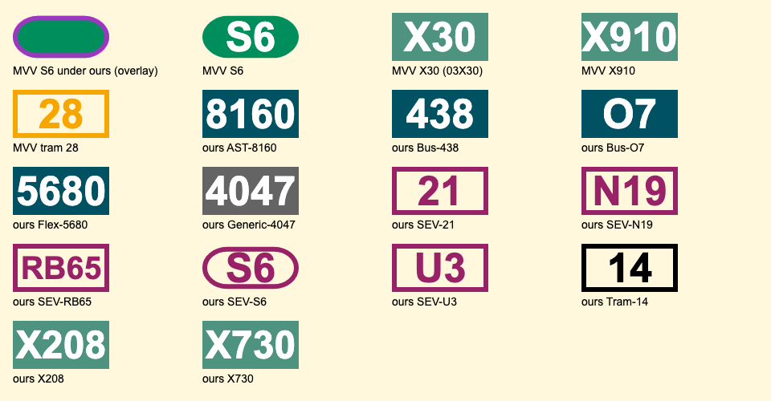

# Line icons

MVV names an icon for every line (`line.symbol` in departures and in
`available_lines`, e.g. `02019.svg`). The client asks the server for it at
`/svg/<file>`, and the server serves MVV's icon from
`https://www.mvv-muenchen.de/fileadmin/lines/`. For about one line in
eight, MVV doesn't have the file; the server then serves MVV's icon under
another name, or draws one in MVV's style. `server/src/icons.ts` decides
what to serve, and `/svg/*filename` in `server/src/handlers.ts` serves it.

When the server has nothing to serve, the client shows the line's name as
text, cut to three letters when it is longer than five (`SEV S6` becomes
`SEV...`).

The samples are in `docs/icons/`; `bazel run //server:icon_samples` redraws
them from the server's code. The preview above is a screenshot, so retake it
by hand after a change. Its top row is MVV's own icons.

## Which icons MVV lacks

On 2026-11-07 we fetched `available_lines` for 1,487 of the 11,062 stops in
`server/data/stops.csv` (denser in Munich and Landkreis München), and checked
every icon they name: 420 distinct lines, 53 icons missing. Departures at
137 of those stops (4,503 departures) name the same icons as
`available_lines`, and no lines that it doesn't list. The missing icons fall
into these classes:

| # | Class | Examples (MVV's file) | What the server serves |
| --- | --- | --- | --- |
| 1 | S-Bahn under its new line code | S1–S8 (`920S1`–`920S8`) | MVV's icon under the old code, `92M01`–`92M08`. |
| 2 | MVG express buses | X30, X35, X36, X80 (`20X30`…) | MVV's icon at `03X30`…, with the right colour and label. |
| 3 | Regional express buses | X205, X206, X208, X730 (`20205`…) | Drawn: express bus colour, label `X208`. (MVV's `19208` is the plain regional bus 208, in another colour.) |
| 4 | SEV for S-Bahn and DB regional trains | SEV S2, S6, S8 (`870S2`…), SEV RB6, RB65, RB67 (`87A03`, `87RB6`) | Drawn: SEV outline, `S6`, `RB65`. RB65 and RB67 share `87RB6.svg`, so the label comes from the line, not the file. |
| 5 | SEV for MVG lines | Tram 21, 25 (`345nn`), U3 (`35503`), N19 (`36719`), X6 (`35596`) | Drawn: SEV outline. MVV gives the replaced line's name (`U3`), which is the label as it is. |
| 6 | New or temporary MVG lines | Tram 14 (`02014`), bus O7 (`03407`) | Drawn: tram 14 as a black outline, like MVV's tram 28; bus O7 in bus colour. |
| 7 | Regional on-demand and town buses | FLEXlinie 2100, 5010… (`16xxx`), AST 8150… (`lvg:`), StadtBus 724 Dachau (`65724`) | Drawn in bus colour. |
| 8 | Operators outside MVV | Allgäu (`rva:`), Oberbayern (`rvo:`), Inn (`mul:`), Tyrol (`vvt:`, the Innsbruck S6 `92AS6`), Regensburg (`gfn:`) | Drawn in grey. |
| 9 | MVV's own wrong icon | Bus 438 (`12438.svg` reads `9441`) | Drawn in place of MVV's: bus colour, `438`. |

## MVV's template

Every MVV icon is the same SVG: `viewBox="0 0 1000 500"`, a coloured
rectangle (a rounded pill for the S-Bahn), and the line's number centred in
bold Arial at 425px. The drawn icons use the same template.

| Family | Background | Text |
| --- | --- | --- |
| Bus, regional bus, StadtBus, FLEXlinie | `#005262` | white |
| Express bus (X…) | `#4d9380` | white |
| HEX, Lufthansa Express | `#646464` | white |
| MetroBus | `#ec6726` | white |
| Night bus and night tram (MVG) | `#1d1d1b` | `#fbba00` |
| Regional night bus | `#f7a600` | white |
| Tram, U-Bahn, S-Bahn | one colour per line | white |

Tram 28 is an outline: an orange frame, orange number and no fill.

## What the server serves

For `/svg/<file>`, in this order:

1. **Names that can't be MVV's** are refused (404) without asking MVV:
   MVV's names are five capitals or digits plus `.svg`.
2. **Overrides,** MVV files that exist but are wrong, are drawn instead
   (`icons.overrides`: `12438.svg`, bus 438).
3. **MVV's file,** sent with a 10-day max-age. If MVV answers 404 or 410,
   its file under another name (`icons.renamedIcon`): `920S<n>` →
   `92M0<n>`, `20X<nn>` → `03X<nn>`.
4. **A drawn icon** if MVV has neither (`icons.drawIcon`), sent with a
   1-day max-age in case MVV adds the real one. The file name alone can't
   say what to draw (classes 4 and 5), so the client passes the line as
   query parameters:
   `?name=SEV%20S6&product=Ersatzverkehr&id=ddb:870S6:A:H:j26`. Without
   them, the answer is 404.

## How missing icons are drawn

The drawing is chosen from the line's product (`line.product`: `SEV`,
`Ersatzverkehr`, `ExpressBus`, `Tram`, `FLEXlinie`, `AST`…) and its
operator (the first part of the line id), in this order:

- **Rail replacement (`SEV` or `Ersatzverkehr`):** an outline in `#992168`,
  the purple of the
  [Ersatzverkehr sign](https://upload.wikimedia.org/wikipedia/commons/8/89/Schienenersatzverkehr_214544-288243.jpg).
  The label is the line's name without a leading `SEV ` (`SEV S6` shows
  `S6`). The shape is that of the line it replaces: a pill when the label
  is `S` and a number, else a rectangle (of MVV's icons only the S-Bahn's
  differs from a rectangle).
- **Outside MVV** (operator other than `ddb`, `swm`, `mvv` or `lvg`), or any
  S-Bahn: filled grey, `#646464`. Munich's S-Bahn icons all exist through
  the rename, so an S-Bahn still without one is elsewhere, like Innsbruck's
  S6 (`ddb:92AS6`).
- **Express bus:** filled `#4d9380`.
- **Tram:** a black outline, like MVV's tram 28.
- **Anything else:** filled bus colour, `#005262`.

Labels keep MVV's 425px when they fit, and shrink when they don't (`RB65`
inside an outline, `5680`). Outlines are a 50-unit stroke inset by 25, so
their outer edge is where MVV's shape ends: tram 28's rectangle, or the
S-Bahn's pill (y 30.6 to 469.4, ends 256.8 wide and 219.4 high, drawn as a
rectangle with rounded corners). Outlines have no fill, so the row colour
shows through, and the label is in the stroke colour.

## Asking MVV as little as possible

mvv-proxy also runs on the internet (mvv.mulambda.de), where asking MVV
for every request could get it rate-limited:

- **Cache.** The server keeps MVV's answer for each file, the icon or that
  it has none, for a day. Requests arriving while MVV is being asked share
  that one request. It keeps 10,000 answers, more than a day's budget, so
  made-up names can't push out the icons people see.
- **Budget** (`ICON_LIMITS` in `server/src/handlers.ts`). Requests to MVV
  for icons may burst to 1,500, enough for a restart's empty cache, then
  about 4,000 a day (one every 21.6 seconds). Only requests that reach MVV
  count, renames included. Normal use costs at most a few thousand a day,
  since each icon is asked for once a day. When the budget is spent, the
  server answers 404 without asking MVV or keeping the answer, and logs it
  once.
- **Concurrency.** At most 8 requests to MVV at once; the rest wait their
  turn. Over HTTP/2 a page asks for all its icons together.
- **No retries.** A missing icon only means text for a while.

If MVV fails with 5xx or another 4xx (such as 429), or the connection
drops, nothing is drawn and nothing is kept: the client shows the line's
name, and the next request asks MVV again. These 404s are sent with
`Cache-Control: no-store`, because Cloudflare, in front of
mvv.mulambda.de, caches 404s without one for 4 hours. A 404 for an icon MVV
really lacks carries no such header and may be cached.

## Limitations

- A tram MVV has no icon for is drawn as a black outline, like tram 14,
  whatever its real colour.
- A night bus without an icon would be drawn in bus colour, and a night
  tram as a black outline, not in MVV's night colours. None were missing
  in the survey.
- The classes above are from the survey; MVV's set of missing icons
  changes with each timetable.
