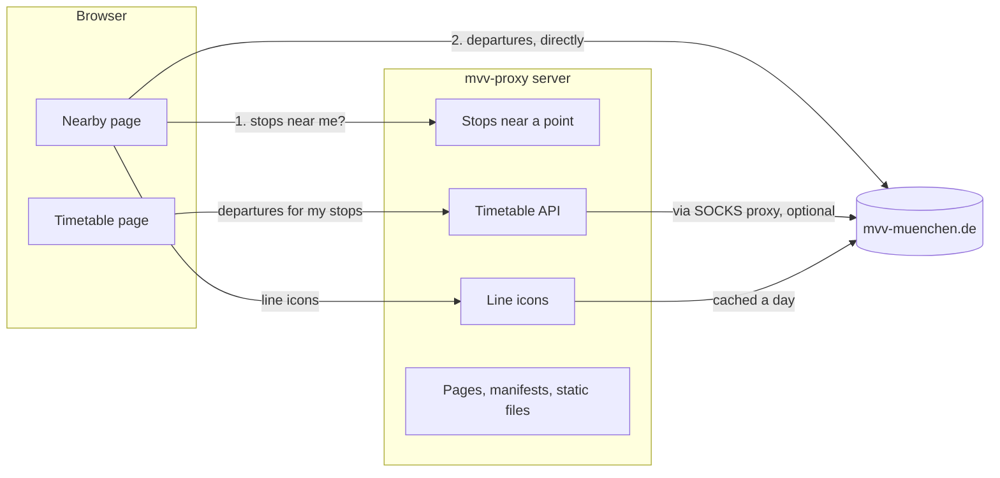

# How mvv-proxy works

mvv-proxy shows departures of Munich's public transport (MVV: S-Bahn,
U-Bahn, tram and bus) on two kinds of screens:

- **The nearby page**, public at [mvv.mulambda.de](https://mvv.mulambda.de).
  A visitor taps one button, allows their location, and sees every
  departure in the next half hour from all the stops within about 500 m,
  in one list. No app, no account, no cookies, nothing to set up.
- **The timetable**, for a Raspberry Pi kiosk at home. It shows the
  departures of a fixed set of stops and lines, chosen in a configuration
  file, and refreshes by itself. The Pi's setup lives in the separate
  pi-kiosk repository, which checks this one out.

Both are served by the same Node server. All departure data comes from
MVV's website, mvv-muenchen.de, which has no official API: mvv-proxy uses
the same JSON endpoints MVV's own departure finder uses.

## The big picture

The two pages get their departures differently:

- **The nearby page asks MVV itself.** The server only turns the
  visitor's location into a list of nearby stops, from a stop list it
  keeps locally. The browser then fetches the departures for those stops
  straight from MVV. The server never sees which departures a visitor
  looks at, and doesn't add to MVV's traffic for them.
- **The timetable asks the server,** which fetches the departures from MVV
  for the stops in its configuration file. On the Pi it can go through a
  SOCKS proxy.

Both use the same code to query MVV (`shared/`), once in the browser and
once in Node.

## Asking MVV for departures

`queryDepartures.Q` (in `shared/src/queryDepartures.ts`) does the work:

1. **Which lines.** A request lists stops, and for each stop the lines
   wanted (or none, meaning all). Lines are named by line and direction,
   such as `S6-i` (see `server/src/lines.ts`), not by MVV's internal line
   ids: those change every December, and sometimes in between. `Q` looks
   the line up in MVV's list of the lines at that stop (`available_lines`)
   and keeps that list for 24 hours.
2. **Departures.** It asks MVV for each stop's departures
   (`get_departures`), all stops at once, starting from when you could be
   at that stop: each stop in a request carries the time it takes to get
   there (for the nearby page, the distance at 60 m a minute). Each stop
   is reported as soon as its departures arrive, which the nearby page
   shows as a check mark next to the stop.
3. **Merging.** It merges the stops' departures into one list sorted by
   time, cut off at the request's limit (30 minutes for the nearby page).

The departure table then shows each line only at its closest stop, so a
bus that passes three nearby stops appears once. A departure blinks when
you'd have to leave now to catch it: within the walk to its stop plus
four minutes.

## The server

An Express 5 server (`server/src/server.ts`), started by
`server/src/main.ts`:

| Address | What it is |
| --- | --- |
| `/`, `/de`, `/en` | The nearby page. `/de` and `/en` fix the language; `/` picks it from the browser's preferred languages. |
| `/de.webmanifest`, `/en.webmanifest` | Manifests that let the page be installed to a phone's home screen. |
| `/timetable.html` | The kiosk's timetable page. |
| `/api/v1/stopsNearby?lat=…&long=…&d=…` | The stops within `d` metres (default 500), and a ready-made request for their departures. |
| `/api/v1/timetable?timestamp=…` | Departures for the configured stops (404 if none are configured). |
| `/api/v1/stops`, `/api/v1/lines` | The stop list and the known lines. |
| `/svg/<file>` | Line icons (see below). |
| `/impressum`, `/datenschutz` | Legal notice and privacy notice, from the operator file (404 without one). |
| everything else | Static files from `www/` and `fonts/`. |

**Stops** come from MVV's open data: `server/data/stops.csv` has every
stop's name, town, global id and position. The server loads it at start
and puts it in a quadtree (`server/src/geo.ts`) to find the stops near a
point quickly.

**The HTML** of the nearby page is written by the server
(`server/src/page.ts`), in German or English, with the right title,
description and link preview for each. The page's text, both what the
server writes and what the browser shows, is in `shared/src/strings.ts`.

### Line icons

Each departure names an icon file on MVV's site for its line. The server
passes these through at `/svg/<file>`, with care, because the public site
must not get it rate-limited by MVV:

- It keeps MVV's answer for each icon, the icon or "none", for a day, and
  clients asking for the same icon at the same time share one request.
- It refuses names that can't be MVV's without asking.
- Requests to MVV for icons have a budget (1,500 at once, then about 4,000
  a day), at most 8 run at once, and each is tried once.

For about one line in eight, MVV has no icon. The server then serves
another of MVV's icons that fits, or draws one in MVV's style from the
line's name and type, which the client passes along
(`server/src/icons.ts`). [MVV-ICONS.md](MVV-ICONS.md) has the survey of
what's missing and the decisions behind each drawing.

The platform and stop signs next to a departure (`Gleis-3.svg`,
`Bussteig-2.svg`) are drawn at build time by `tools/gen-stop-signs.ts`.

## The client

React, bundled by esbuild into two scripts:

- `client/src/index.tsx`: the nearby page. It shows a short introduction
  until the visitor asks for departures, so the browser asks for the
  location only then (a visitor who already allowed it skips straight to
  the departures). It lists the nearby stops while their departures load,
  then shows the departure table.
- `client/src/timetable.tsx`: the kiosk's timetable. It asks the server
  for the configured departures and refreshes them. If an update fails it
  shows the error rather than stale departures.

`client/src/render.tsx` draws the departure table for both.

The nearby page can be installed ("Add to Home Screen"). It has no
service worker, so it works only online and stores nothing in the browser.

## Privacy

The nearby page is built to need as little as possible:

- No cookies and no browser storage.
- The location is used once, to find the nearby stops. The server's log
  keeps it rounded to two decimals, about a kilometre, and logs are
  deleted after 14 days.
- Departures are fetched from MVV by the browser, so MVV sees the
  visitor's IP address as it would on its own site.
- The PayPal donate image is served from this site, so PayPal learns
  nothing until someone clicks it.

The privacy notice (`/datenschutz`, `server/src/legal.ts`) describes this,
and any change to what the site does with visitor data has to update it.
The operator's name and address, for the legal pages, come from a file on
the public server and are never in this repository
(`server/data/operator.example.yaml` shows its format).

## Where it runs

- **On the Pi:** the pi-kiosk repository builds the server with Bazel and
  runs it as a systemd service (the server tells systemd when it's ready).
  It serves the timetable to the kiosk's browser, from the stops in its
  request file.
- **On the public server:** as a container image
  (`docker.io/mulambda/mvv-proxy`, built by Bazel with rules_oci), run with
  Docker Compose on a rented server behind Cloudflare. `update-prod.sh`
  tests, pushes the image and restarts it there.

The server's settings are environment variables: the port, the stop list,
the timetable's request file, the operator file and the SOCKS proxy. They
are described in [AGENTS.md](../AGENTS.md).

## The repository

| Directory | What's in it |
| --- | --- |
| `server/` | The server, its stop data (`data/`) and its tests. |
| `shared/` | Code for both server and browser: querying MVV, types, the page's text. |
| `client/` | The two React pages and the departure table. |
| `www/` | Static files: CSS, the timetable's HTML, icons and images. |
| `fonts/` | The fonts the pages use. |
| `tools/` | The stop-sign generator. |
| `tests/` | Tests of the departure queries against recorded MVV answers, and a tool to record new ones. |
| `docs/` | This overview, the icon notes and sample icons. |

Everything is TypeScript, built and tested with Bazel (`bazel build //...`,
`bazel test //...`), with pnpm for the JavaScript packages.

## Further reading

- [AGENTS.md](../AGENTS.md): the detailed notes for working on the code:
  build quirks, conventions, and why things are the way they are.
- [MVV-ICONS.md](MVV-ICONS.md): line icons MVV doesn't have.
- [PROMOTION.md](../PROMOTION.md): the plan for making the public site
  better known.
